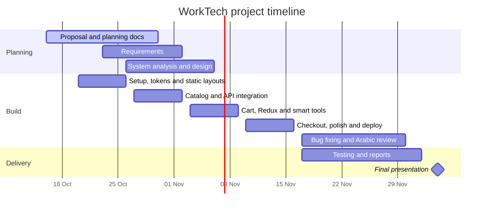
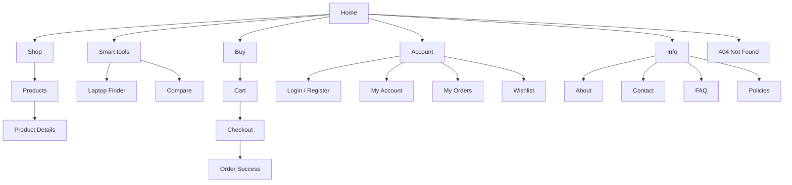

# WorkTech: Project Documentation

**E-commerce Storefront for Laptops with React**

| | |
|---|---|
| **Initiative** | Digital Egypt Pioneers Initiative (DEPI), Round 5 |
| **Track** | React Front-End Web Developer |
| **Group code** | ALX5_SWD2_S1 |
| **Instructor** | Eng. Abdelwahab |
| **Training company** | Skills Dynamix |
| **Team leader** | Salem Saleh |
| **Repository** | https://github.com/nhahub/NHA-5-046 |

> *Better Tech. Brighter Future.*

---

## Table of contents

1. [Project Planning & Management](#1-project-planning--management)
   - [1.1 Project Proposal](#11-project-proposal)
   - [1.2 Project Plan](#12-project-plan)
   - [1.3 Task Assignment & Roles](#13-task-assignment--roles)
   - [1.4 Risk Assessment & Mitigation Plan](#14-risk-assessment--mitigation-plan)
   - [1.5 Key Performance Indicators (KPIs)](#15-key-performance-indicators-kpis)
2. [Requirements Gathering](#2-requirements-gathering)
   - [2.1 Functional requirements](#21-functional-requirements)
   - [2.2 Non-functional requirements](#22-non-functional-requirements)
   - [2.3 User stories](#23-user-stories)
3. [Implementation, Testing & Deployment](#3-implementation-testing--deployment)
   - [3.1 Technical approach](#31-technical-approach)
   - [3.2 Testing plan](#32-testing-plan)
   - [3.3 Deployment](#33-deployment)
   - [3.4 User manual](#34-user-manual)
4. [Appendices](#4-appendices)

---

# 1. Project Planning & Management

## 1.1 Project Proposal

### Project name
**WorkTech** is a laptop e-commerce store built with React.

### Objective
Build a responsive, client-facing laptop store with a product catalog, shopping cart and checkout. Go beyond a standard store with tools that help buyers choose the right laptop: a **Laptop Finder**, **side-by-side comparison**, a **Value Score** and clear **monthly installments**.

### Description
WorkTech is a modern web store where users browse laptops, filter them by real specifications, view full product details, add items to a cart and complete a simulated checkout. Product data comes from a REST API (a mock API served from JSON data), and Redux manages the cart, wishlist and comparison across the app. The site has **17 pages** and is designed for desktop (1440 px), tablet (834 px) and mobile (390 px). It supports **English and Arabic**, including a right-to-left layout.

### Scope

**In scope**
- Product catalog with search, filters, sorting and "Load more".
- Product details with specs, options, reviews, ratings and an installment calculator.
- Cart, 3-step checkout with form validation, order confirmation.
- Demo user accounts (login/register), My Account, My Orders with order details, Wishlist with price-drop alerts.
- Laptop Finder (4-question wizard) and Compare (up to 3 laptops).
- Information pages: About, Contact, FAQ, Policies, and a 404 page.
- English / Arabic with RTL.
- Deployment to a public URL.

**Out of scope**
- A real database or production backend. Data comes from a mock REST API.
- Real payments. Checkout is simulated.
- Real user authentication and security. Demo accounts live in the browser.
- An admin dashboard.

### Tools and technologies

| Area | Tool | Purpose |
|---|---|---|
| Front end | React 18 + Vite | UI and fast build tooling |
| Routing | React Router | Navigation across the 17 routes |
| State | Redux Toolkit | Cart, wishlist, compare, user |
| HTTP | Axios | Calls to the REST API |
| Mock API | JSON Server | REST endpoints from a JSON file |
| i18n | i18next | English / Arabic and RTL |
| Styling | CSS Modules + design tokens | Consistent, scoped styles |
| Design | Figma, Claude Design | UI design and interactive prototype |
| Testing | Vitest + React Testing Library | Unit and component tests |
| Version control | Git + GitHub | Branches, pull requests, reviews |
| Deployment | Vercel | Hosting and preview deployments |

### Brand

| Token | Value |
|---|---|
| Red | `#D1040B` |
| Blue | `#0264CF` |
| Gold | `#F7A909` |
| Sky | `#32B5FD` |
| Ink | `#0B1526` |
| Font | IBM Plex (Sans / Sans Arabic) |

---

## 1.2 Project Plan

### Milestones (DEPI)

| Milestone | Deadline |
|---|---|
| Project Planning & Management | 16 Oct 2026 |
| Requirements Gathering | 16 Oct 2026 |
| System Analysis & Design | 6 Nov 2026 |
| Implementation (source code & execution) | 30 Nov 2026 |
| Final Presentation & Testing / Reports | 4 Dec 2026 |

### Timeline (Gantt)



### Weekly plan, deliverables and exit criteria

| Week | Dates | Focus | Deliverables |
|---|---|---|---|
| 1 | 20–26 Oct | Setup and static layouts | React + Vite project on GitHub; router with all 17 routes; design tokens; Header, Footer, Product Card; static Home, Products, Cart and Checkout layouts; mock API with first endpoints |
| 2 | 27 Oct – 2 Nov | Catalog and API integration | Products and Product Details on live API data; filters, sorting, search; installment calculator; EN/AR switch with RTL; Login / Register with validation |
| 3 | 3–9 Nov | Cart, state and smart tools | Redux store (cart, wishlist, compare, user) persisted in localStorage; Cart page; Compare; Laptop Finder; Wishlist, Account and Orders; information pages |
| 4 | 10–16 Nov | Checkout, testing and deployment | 3-step checkout and Order Success; UI polish and accessibility; end-to-end flow test; deployment to Vercel; README and project documentation |
| After | 17–30 Nov | Stabilization | Bug fixing, Arabic content review and final checks before the 30 Nov implementation deadline |
| After | 1–4 Dec | Reports and presentation | Testing report, final report and presentation on 4 Dec |

### Working rules (team constants)

- **Branches:** `main` (always deployable), `develop` (integration), `feature/<name>` (one per task).
- **Pull requests:** every change goes through a PR with at least one review. No direct pushes to `main` or `develop`.
- **Commits:** small and clear, in the form `feat: add product filters`, `fix: cart total rounding`.
- **Definition of Done:** the feature works at all 3 screen sizes, handles loading, empty and error states, works in English and Arabic, has no console errors, and has been reviewed and merged.
- **Rhythm:** a short weekly planning meeting, a brief progress update twice a week, and a demo of merged work at the end of each week.

---

## 1.3 Task Assignment & Roles

> This table is to be filled in by the team leader. Names are in the order they joined the team.

### Team

| # | Member | Role | Main responsibility |
|---|---|---|---|
| 1 | Salem Saleh | Team Leader | |
| 2 | Abdelrahman Hany Mohamed | | |
| 3 | Fares Ahmed Mostafa Slim | | |
| 4 | Wassim Gomaa El-Sakka | | |
| 5 | Zein El-Din Amr El-Sayed Ahmed | | |
| 6 | Asmaa Nehad Farouk | | |

### Page ownership

| # | Page | Route | Owner | Reviewer |
|---|---|---|---|---|
| 01 | Home | `/` | | |
| 02 | Products | `/products` | | |
| 03 | Product Details | `/products/:id` | | |
| 04 | Cart | `/cart` | | |
| 05 | Checkout | `/checkout` | | |
| 06 | Order Success | `/order-success` | | |
| 07 | Login / Register | `/auth` | | |
| 08 | My Account | `/account` | | |
| 09 | My Orders | `/orders` | | |
| 10 | Wishlist | `/wishlist` | | |
| 11 | Laptop Finder | `/finder` | | |
| 12 | Compare | `/compare` | | |
| 13 | About | `/about` | | |
| 14 | Contact | `/contact` | | |
| 15 | FAQ | `/faq` | | |
| 16 | Policies | `/policies` | | |
| 17 | Not Found | `*` | | |

### Shared work

| Area | Owner |
|---|---|
| Design tokens and shared components (Header, Footer, Product Card) | |
| Redux store (cart, wishlist, compare, user) | |
| Mock API and product data | |
| English / Arabic and RTL | |
| Testing | |
| Deployment, README and documentation | |

---

## 1.4 Risk Assessment & Mitigation Plan

Likelihood and impact are rated **L** (low), **M** (medium) or **H** (high).

| ID | Risk | Likelihood | Impact | Mitigation | Contingency |
|---|---|---|---|---|---|
| R1 | The schedule is tight, and the planning documents are already late | H | H | Fixed weekly goals, small tasks, and a prioritized list of must-have features | Cut nice-to-have features (for example, price-drop alerts) before core flows |
| R2 | Team members have different skill levels in React and Redux | H | M | Pair programming; a shared walkthrough of the project structure; clear coding conventions | Reassign tasks so that complex ones go to experienced members |
| R3 | Merge conflicts and broken `main` | M | H | Feature branches, small PRs, reviews, and a deploy preview for every PR | Revert the last merge and fix on a branch |
| R4 | A teammate is unavailable or stops contributing | M | H | Every page has an owner and a reviewer; weekly check-ins | The leader redistributes the tasks and flags the issue to the instructor |
| R5 | Scope creep from "one more feature" | M | M | A written scope list (see 1.1); new features go to a backlog and need the leader's approval | Freeze features after Week 3 |
| R6 | Design and code drift apart (styles, spacing, responsive behavior) | M | M | Shared design tokens; the Figma file is the source of truth; responsive check at 3 sizes in the Definition of Done | A UI polish pass in Week 4 |
| R7 | The mock API is not enough or changes shape mid-project | M | M | Agree the API contract (endpoints and fields) in Week 1 and keep it versioned in the repo | Add a small adapter layer so UI code is not tied to the data shape |
| R8 | Arabic (RTL) breaks layouts late in the project | M | M | Use logical CSS properties (`margin-inline-start`) from day 1; test RTL on every page as it is built | Dedicated RTL review in the stabilization phase |
| R9 | Deployment problems near the deadline | L | H | Deploy on day 1 and keep it deployed; every PR gets a preview URL | Fall back to a previous deployment |
| R10 | Product photos, copy and legal text are not ready | M | L | Use clearly labelled placeholder content and replace it before the final week | Keep placeholders if real content is not available |
| R11 | Bugs found too late because tests are written at the end | M | M | Test each page as it is merged; keep the testing plan in 3.2 | Allocate the stabilization phase to bug fixing |

---

## 1.5 Key Performance Indicators (KPIs)

| Area | KPI | Target | How it is measured |
|---|---|---|---|
| Delivery | Pages implemented and merged | 17 of 17 by 30 Nov | Page ownership table (1.3) |
| Delivery | Weekly deliverables completed on time | 100% of must-have items | Week-end demo against the weekly plan |
| Delivery | Open critical or blocking bugs at submission | 0 | GitHub Issues labelled `critical` |
| Quality | Pull requests reviewed before merge | 100% | GitHub PR history |
| Quality | Automated test pass rate | 100% passing; core logic covered | Vitest report |
| Quality | Console errors on the main flow | 0 | Manual check on the deployed build |
| Performance | Lighthouse Performance (mobile) | 85 or higher | Lighthouse on the deployed build |
| Performance | Lighthouse Accessibility | 90 or higher | Lighthouse |
| Performance | Lighthouse Best Practices and SEO | 90 or higher | Lighthouse |
| Performance | Largest Contentful Paint on Home | Under 2.5 s | Lighthouse / Web Vitals |
| Usability | Responsive layouts verified | 3 sizes × 17 pages | Responsive checklist |
| Usability | Bilingual support | All pages work in EN and AR (RTL) | Manual check |
| Usability | Time for a new user to complete browse → cart → checkout | Under 3 minutes | Informal usability test with 3–5 people |
| Process | Team meeting attendance | At least 90% | Meeting notes |

---

# 2. Requirements Gathering

## 2.1 Functional requirements

Priority follows MoSCoW: **M** = Must, **S** = Should, **C** = Could.

### Catalog and search

| ID | Requirement | Priority |
|---|---|---|
| FR-01 | The system shall list laptops from the API with image, name, price, rating and key specs. | M |
| FR-02 | The user shall filter by brand, price range, RAM, processor, graphics, screen size, customer rating, and in-stock only. | M |
| FR-03 | The user shall sort products by price, rating and newest. | M |
| FR-04 | The user shall search products by name or keyword, and see a results page with a result count. | M |
| FR-05 | The product list shall load more items with a "Load more" button and a progress indicator. | S |
| FR-06 | Filters and search shall be reflected in the URL so that results can be shared and the Back button works. | S |
| FR-07 | Product cards shall show a low-stock label when stock is limited. | C |

### Product details

| ID | Requirement | Priority |
|---|---|---|
| FR-08 | The product page shall show an image gallery, full specification table and description. | M |
| FR-09 | The user shall choose options (memory, storage, warranty), and the price shall update accordingly. | M |
| FR-10 | The page shall show an installment calculator with a clear monthly amount. | S |
| FR-11 | The page shall show the average rating, a rating breakdown and customer reviews, and let the user mark a review as helpful. | S |
| FR-12 | The user shall be able to add the product to the cart, the wishlist, or the compare list, or use "Buy now". | M |

### Cart and checkout

| ID | Requirement | Priority |
|---|---|---|
| FR-13 | The user shall add, remove and change the quantity of items in the cart. | M |
| FR-14 | The cart shall show subtotal, discount, shipping and total, and apply a promo code. | M |
| FR-15 | The cart badge in the header shall always show the current number of items. | M |
| FR-16 | The cart shall persist after the page is refreshed (localStorage). | M |
| FR-17 | Checkout shall have 3 steps (shipping, payment, review) with form validation and clear error messages. | M |
| FR-18 | After checkout, the user shall see an Order Success page with an order number and a delivery timeline. | M |

### Accounts and orders

| ID | Requirement | Priority |
|---|---|---|
| FR-19 | The user shall register and log in with demo accounts stored in the browser, with form validation. | M |
| FR-20 | The user shall see and update their account details and saved addresses on My Account. | S |
| FR-21 | The user shall see the order history on My Orders and open an order's details with its status steps. | M |
| FR-22 | The user shall save laptops to a Wishlist and see price-drop alerts. | S |

### Smart tools

| ID | Requirement | Priority |
|---|---|---|
| FR-23 | Laptop Finder: a 4-question wizard that returns ranked laptops with a short reason for each. | S |
| FR-24 | Compare: up to 3 laptops side by side, with the best value highlighted and a "differences only" toggle. | S |
| FR-25 | Each laptop shall show a Value Score. | C |

### General

| ID | Requirement | Priority |
|---|---|---|
| FR-26 | The site shall be available in English and Arabic, with a language switch and right-to-left layout. | M |
| FR-27 | The site shall provide About, Contact (with a validated form), FAQ (searchable) and Policies pages. | M |
| FR-28 | Unknown routes shall show a friendly 404 page. | M |
| FR-29 | Every data-driven page shall show loading, empty and error states. | M |

## 2.2 Non-functional requirements

| ID | Category | Requirement |
|---|---|---|
| NFR-01 | Responsiveness | All 17 pages shall work on desktop (1440 px), tablet (834 px) and mobile (390 px) without horizontal scrolling. |
| NFR-02 | Performance | Lighthouse Performance of 85 or higher on mobile; Largest Contentful Paint under 2.5 s on Home. |
| NFR-03 | Accessibility | Lighthouse Accessibility of 90 or higher; keyboard navigation, visible focus, alt text on images, and sufficient color contrast (WCAG 2.1 AA). |
| NFR-04 | Localization | Full English and Arabic support, with RTL layout and no hard-coded strings in components. |
| NFR-05 | Browser support | Latest two versions of Chrome, Edge, Firefox and Safari; Chrome on Android and Safari on iOS. |
| NFR-06 | Maintainability | Component-based structure, one folder per feature, shared design tokens, and consistent naming. |
| NFR-07 | Code quality | ESLint and Prettier on every commit or PR; no unused code in `main`. |
| NFR-08 | Reliability | The UI shall handle API failure without crashing, showing an error state and a retry action. |
| NFR-09 | Security (front end) | No secrets in the repository; user input is validated and rendered safely (no `dangerouslySetInnerHTML` on user data). Payment is simulated, so no real card data is processed or stored. |
| NFR-10 | Usability | Consistent navigation, clear feedback after actions (for example, "Added to cart"), and a primary flow reachable in 3 clicks from Home. |
| NFR-11 | Deployability | One-command local setup (`npm install && npm run dev`) and automatic deploys from `main`. |
| NFR-12 | Documentation | README with setup, scripts and structure; this documentation kept up to date. |

## 2.3 User stories

Each story follows *As a [user], I want [goal], so that [benefit]*.

### Shopper

**US-01 · Find a laptop by specs**
As a shopper, I want to filter laptops by brand, price, RAM and processor, so that I only see laptops that fit my needs.
*Acceptance criteria:*
- Selecting a filter updates the list and the result count.
- Several filters can be combined and cleared together.
- The URL reflects the selected filters.

**US-02 · Search**
As a shopper, I want to search by name or keyword, so that I can reach a specific laptop quickly.
*Acceptance criteria:*
- Searching shows a results page with the keyword and the count.
- Searching with no matches shows an empty state with suggestions.

**US-03 · Understand a product**
As a shopper, I want to see full specs, options and reviews on a product page, so that I can decide with confidence.
*Acceptance criteria:*
- The page shows gallery, specs, rating breakdown and reviews.
- Choosing memory, storage or warranty updates the price.

**US-04 · Know what I will pay monthly**
As a shopper, I want an installment calculator, so that I can see the monthly cost before I buy.
*Acceptance criteria:*
- Changing the number of months updates the monthly amount.
- The total and the monthly amount are clearly labelled.

**US-05 · Get a recommendation**
As a shopper who is not sure what to buy, I want to answer a few questions, so that the store recommends laptops for me.
*Acceptance criteria:*
- The wizard has 4 questions and a progress indicator.
- Results are ranked, and each has a short reason.

**US-06 · Compare**
As a shopper, I want to compare up to 3 laptops side by side, so that I can see the differences.
*Acceptance criteria:*
- A fourth laptop cannot be added, and the user is told why.
- "Differences only" hides rows that are the same.
- The best value is highlighted.

**US-07 · Save for later**
As a shopper, I want to save laptops to a wishlist, so that I can come back to them later.
*Acceptance criteria:*
- Adding or removing from the wishlist updates the heart icon immediately.
- The wishlist remains after a refresh.

**US-08 · Manage my cart**
As a shopper, I want to change quantities and apply a promo code, so that I can control my order total.
*Acceptance criteria:*
- Totals update immediately after each change.
- An invalid promo code shows a clear message.
- The cart survives a page refresh.

**US-09 · Check out**
As a shopper, I want a simple checkout, so that I can complete my order without confusion.
*Acceptance criteria:*
- Checkout has 3 steps, and the user cannot continue with invalid fields.
- Errors appear next to the field that caused them.
- After confirmation, an order number is shown.

### Account holder

**US-10 · Create an account and log in**
As a visitor, I want to register and log in, so that my orders and wishlist are linked to me.
*Acceptance criteria:*
- Register validates name, email and password rules.
- A wrong password shows an error without clearing the email field.

**US-11 · Track my orders**
As a customer, I want to see my orders and their status, so that I know when my laptop will arrive.
*Acceptance criteria:*
- My Orders lists past orders with status.
- "View order" opens a detail view with status steps and items.

### Any user

**US-12 · Use the site in Arabic**
As an Arabic-speaking user, I want to switch the site to Arabic with a right-to-left layout, so that I can read it naturally.
*Acceptance criteria:*
- The switch changes text and layout direction on all pages.
- The language choice is remembered.

**US-13 · Use the site on my phone**
As a mobile user, I want pages that fit my screen, so that I can shop comfortably.
*Acceptance criteria:*
- No horizontal scrolling at 390 px.
- Buttons and links are easy to tap.

**US-14 · Get help**
As a shopper, I want an FAQ, policies and a contact form, so that I can get answers before I buy.
*Acceptance criteria:*
- FAQ search filters the questions.
- The contact form validates fields and confirms sending.

### Team

**US-15 · Merge safely**
As a team member, I want every change to go through a reviewed pull request with a preview, so that `main` is always deployable.
*Acceptance criteria:*
- PRs need at least one review.
- Each PR has a preview URL.

---

# 3. Implementation, Testing & Deployment

## 3.1 Technical approach

### Build order
1. Set up the project, deploy it, and agree on conventions.
2. Design tokens and shared components.
3. Layout and routes (all 17 routes with placeholder pages).
4. Mock API and data layer.
5. Static pages from the design, at 3 sizes.
6. Connect real data (loading, success, empty and error states).
7. Redux (cart, wishlist, compare, user).
8. Features (checkout, finder, compare, orders).
9. Arabic and RTL.
10. Polish, testing, final deployment and documentation.

### Where each kind of state lives

| State | Where | Example |
|---|---|---|
| Server data | API calls and hooks | Product list, product details |
| Shared app state | Redux Toolkit | Cart, wishlist, compare, user |
| Local UI state | `useState` | Open dropdown, selected tab |
| Filters and search | URL parameters | `?brand=asus&ram=16` |
| Persistence | localStorage | Cart, wishlist, language, demo accounts |

### Mock API contract

| Method | Endpoint | Purpose |
|---|---|---|
| GET | `/products` | List products, with query parameters for filtering, sorting and paging |
| GET | `/products/:id` | One product with specs and options |
| GET | `/products/:id/reviews` | Reviews of a product |
| GET | `/orders` | Orders of the current user (demo) |
| POST | `/orders` | Create an order (demo) |

### Suggested folder structure

```text
src/
  api/          # Axios instance and API functions
  assets/       # Images, icons, fonts
  components/   # Shared components (Button, Header, Footer, ProductCard)
  features/     # cart, wishlist, compare, user (Redux slices)
  hooks/        # Reusable hooks (useProducts, useDebounce)
  i18n/         # Translation files (en, ar)
  pages/        # One folder per page
  routes/       # Route definitions
  styles/       # Design tokens and global CSS
  utils/        # Helpers (formatPrice, calcInstallment)
  main.jsx
```

---

## 3.2 Testing plan

### Objectives
Confirm that the main flows work, that the site is usable at 3 screen sizes in both languages, and that no critical bugs remain at submission.

### Levels of testing

| Level | What | Tool | Who |
|---|---|---|---|
| Unit | Pure logic: price formatting, installment calculation, Value Score, cart reducers | Vitest | The author of the feature |
| Component | Rendering and behavior: Product Card, filters, forms, cart item | React Testing Library | The author of the feature |
| Manual functional | Full user flows on the deployed build | Test cases below | Rotating tester (not the author) |
| Responsive | 17 pages at 1440, 834 and 390 px | Browser dev tools and real phones | Each page owner, then a reviewer |
| Localization | English and Arabic (RTL) on every page | Manual | Each page owner |
| Accessibility | Keyboard use, focus, contrast, alt text | Lighthouse, manual check | UI owner and reviewer |
| Performance | Lighthouse on the deployed build | Lighthouse | Team leader |
| Cross-browser | Chrome, Edge, Firefox, Safari | Manual | Team |

### Key test cases

| ID | Area | Steps | Expected result |
|---|---|---|---|
| TC-01 | Catalog | Open Products and select brand + RAM filters | List and count update; URL contains the filters |
| TC-02 | Search | Search for a keyword with no match | Empty state with a helpful message |
| TC-03 | Product | Open a product and change memory and warranty options | Price updates correctly |
| TC-04 | Installments | Change the number of months | Monthly amount recalculates |
| TC-05 | Cart | Add a product twice and increase its quantity | Quantity and totals are correct; the header badge matches |
| TC-06 | Cart | Refresh the page | Cart contents remain |
| TC-07 | Promo | Apply an invalid code, then a valid one | Error message, then the discount appears |
| TC-08 | Checkout | Continue with empty required fields | Errors show next to the fields; cannot continue |
| TC-09 | Checkout | Complete all 3 steps | Order Success with an order number; the order appears in My Orders |
| TC-10 | Auth | Register, log out, log in with a wrong and then a correct password | Wrong password shows an error; correct one succeeds |
| TC-11 | Wishlist | Add and remove a laptop, refresh | State is consistent and persisted |
| TC-12 | Compare | Add 4 laptops | The fourth is refused with a message |
| TC-13 | Finder | Finish the 4 questions | Ranked results with reasons |
| TC-14 | Language | Switch to Arabic on every page | Text and layout are RTL with no overlaps |
| TC-15 | Responsive | Open each page at 390 px | No horizontal scroll; buttons are usable |
| TC-16 | Errors | Stop the API and open Products | Error state with a retry button |
| TC-17 | 404 | Open an unknown URL | The 404 page with links back |

### Bug handling

- Every bug is a GitHub Issue with: steps, expected result, actual result, screenshot, and a severity label (`critical`, `major`, `minor`).
- **Critical** bugs (the user cannot complete the main flow) are fixed first and block a release.
- A bug is closed only after another person verifies the fix.

### Entry and exit criteria

- **Entry:** the feature is merged into `develop` and deployed to a preview.
- **Exit (final submission):** all Must requirements pass their test cases, there are 0 open critical bugs, and the KPI targets in 1.5 are met or documented with a reason.

### Test report

The final testing report (due 4 Dec) will include a table of executed test cases with pass/fail, the Lighthouse scores, the list of known issues, and the lessons learned.

---

## 3.3 Deployment

### Environments

| Environment | Source | Purpose |
|---|---|---|
| Local | Developer machine | Development |
| Preview | Every pull request | Review before merge |
| Production | `main` branch | The public site (Vercel) |

### Run locally

```bash
git clone https://github.com/nhahub/NHA-5-046.git
cd NHA-5-046
npm install
npm run dev        # start the app
npm run test       # run the tests
npm run build      # production build
```

### Deploy to Vercel

1. Import the GitHub repository into Vercel.
2. Framework preset: **Vite**. Build command: `npm run build`. Output directory: `dist`.
3. Add a rewrite so that all routes serve `index.html` (needed for React Router):
   ```json
   { "rewrites": [{ "source": "/(.*)", "destination": "/index.html" }] }
   ```
4. Every push to `main` deploys to production. Every pull request gets a preview URL.

Live URL: *to be added after the first deployment*

### Environment variables

| Variable | Purpose |
|---|---|
| `VITE_API_URL` | Base URL of the mock API |

No secrets are stored in the repository.

---

## 3.4 User manual

### Browse and find a laptop
1. Open **Products** from the top menu, or search from the search bar.
2. Use the filters on the side (brand, price, RAM, processor, graphics, screen, rating, in stock only). On mobile, open them with the **Filters** button.
3. Sort the list from the sort menu. Press **Load more** to see more products.

### Not sure what to buy?
- Open **Laptop Finder**, answer the 4 questions and read the ranked results with the reasons.
- Add up to 3 laptops to **Compare** with the compare button on a card, then open the Compare page. Turn on **Differences only** to see what is different.

### Look at a product
- Open a product to see photos, specifications, ratings and reviews.
- Choose memory, storage and warranty options, and use the installment calculator to see your monthly amount.
- Choose **Add to cart**, **Buy now**, or the heart icon to save it to your wishlist.

### Buy
1. Open the **Cart** from the header. Change quantities and enter a promo code if you have one.
2. Press **Checkout** and complete the 3 steps: **Shipping**, **Payment** and **Review**.
3. After you confirm, you will see your order number and the delivery timeline.
   *This is a demo store: no real payment is made.*

### Your account
- **Register / Login:** use the account icon in the header.
- **My Account:** update your details and addresses.
- **My Orders:** see your orders, and press **View order** for the status and items.
- **Wishlist:** see saved laptops and price-drop alerts.

### Language
Use the language switch in the header to move between **English** and **العربية**. The layout flips to right-to-left in Arabic, and your choice is remembered.

### Help
Open **FAQ**, **Policies** or **Contact** from the footer.

---

# 4. Appendices

## A. Pages of the website (17)

| # | Page | Route | Description |
|---|---|---|---|
| 01 | Home | `/` | Hero, categories, featured laptops, deals, Finder teaser |
| 02 | Products | `/products` | Catalog with spec filters, sort, compare tray |
| 03 | Product Details | `/products/:id` | Specs, options, warranty, installment calculator, reviews |
| 04 | Cart | `/cart` | Quantities, promo code, totals, accessories |
| 05 | Checkout | `/checkout` | 3 steps: shipping, payment, review |
| 06 | Order Success | `/order-success` | Confirmation and delivery timeline |
| 07 | Login / Register | `/auth` | Sign in and create account |
| 08 | My Account | `/account` | Overview, details, addresses, notifications |
| 09 | My Orders | `/orders` | Order history, order details and tracking |
| 10 | Wishlist | `/wishlist` | Saved laptops and price-drop alerts |
| 11 | Laptop Finder | `/finder` | 4-question wizard with ranked results |
| 12 | Compare | `/compare` | Up to 3 laptops side by side |
| 13 | About | `/about` | Project, principles and team |
| 14 | Contact | `/contact` | Contact form and support channels |
| 15 | FAQ | `/faq` | Searchable questions by topic |
| 16 | Policies | `/policies` | Shipping, returns and warranty |
| 17 | Not Found | `*` | Friendly 404 with search and links |

## B. Sitemap



## C. Related deliverables

| Deliverable | Status |
|---|---|
| Figma designs for 17 pages at desktop, tablet and mobile | Done |
| Interactive prototype (Claude Design) | Done |
| System analysis and design diagrams (use case, flow, wireframes) | Due 6 Nov 2026 |
| Source code | Due 30 Nov 2026 |
| Final presentation and testing report | Due 4 Dec 2026 |
